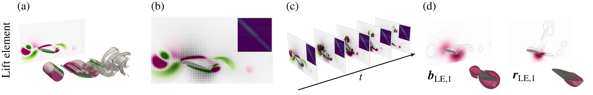

# Force-element network

Sample code for building force-element networks of a flow around a wing and
extracting their communicability modes, as used in

> S. Yamamoto and K. Fukami, "Lift element-based dynamic network of vortex
> gust–airfoil interactions," in preparation.

The lift element (LE) is used here as a representative force element; other
force components follow by changing the auxiliary potential `phi`.



## Repository structure

```
.
├── adjacency_3d.py          # LE adjacency matrix of a 3D flow
├── comm.py                  # time-evolving Katz communicability and its forcing / receive / hub modes
├── visualize_3d.ipynb       # 3D flow (Q isosurfaces, z-mean L_E), modes and singular values,
│                            #   in the style of the paper figures
├── sample/
│   └── g2_d0.5_101-110.npz  # 10 snapshots of a 3D wing–gust interaction
│                            #   (Re = 1000, AoA = 18°, G = 2, D = 0.5c)
├── summary.png              # overview figure shown above
├── requirements.txt
├── outputs/                 # generated, not tracked
│   └── le3d/
│       ├── frame_*.npz      #   adjacency matrices (adjacency_3d.py)
│       └── comm.npz         #   communicability and modes (comm.py)
└── figures/                 # generated by visualize_3d.ipynb, not tracked
```

## Quick start

```bash
pip install -r requirements.txt

python adjacency_3d.py          # -> outputs/le3d/frame_*.npz
python comm.py outputs/le3d     # -> outputs/le3d/comm.npz
```

Then run `visualize_3d.ipynb`; figures are saved to `figures/` (flow fields and
modes as PNG, singular values as PDF). Parameters (`SKIP`, `EPS`, `BETA`, ...)
are constants at the top of each script. Each step takes a few seconds on the
sample (2,422 nodes).

## Method

**Lift element.** With the auxiliary potential `phi` of the wing for the lift
direction, the lift is the volume integral of the lift element

`L_E = -(L_x dphi/dx + L_y dphi/dy)`,  `L = omega x u`,

plus surface terms. The minus sign corresponds to `dphi/dn = +n_y` with the
normal pointing into the wing; it is the same as `(omega x u) . grad(phi)` with
`dphi/dn = -n_y` used in the paper.

Vorticity is read from the data where available; the sample stores `omega_z`
only, so `omega_x` and `omega_y` are computed from the velocity. Which
components come from the data or the velocity is switched by commenting the
marked lines in `lift_element()` (and, for data with all three components, the
`omega_x`, `omega_y` lines in the loop of `adjacency_3d.py`).

**Adjacency.** A small velocity perturbation `du_j = curl(psi_j q)` with a
Gaussian `psi_j` of amplitude `eps` and axis `q = (1, 1, 1)/sqrt(3)` is placed at
node `j`. It is divergence-free, and its vorticity perturbs all three components
around `x_j`. The edge weight is

`A[i, j] = | L_E(u + du_j)(x_i) - L_E(u)(x_i) | / eps`,

where the vorticity in `L_E(u + du_j)` includes that of the perturbation.

**Communicability.** For adjacency matrices sampled every `dt`,

`C_k = (I - alpha A_k)^(-1) (I + exp(-dt*) (C_{k-1} - I))`,  `C_0 = I`,

with `alpha = beta dt` and `dt* = dt / gamma`, where `gamma` is the memory time
scale in convective units. The SVD `C_K = R S B^T` gives the forcing modes `B`,
receive (response) modes `R`, and hub modes `H = R * B` (elementwise). The
defaults `beta = 1` and `gamma = 1` correspond to `alpha = dt` and an age
downweighting of `exp(-dt)` per step in the paper.
